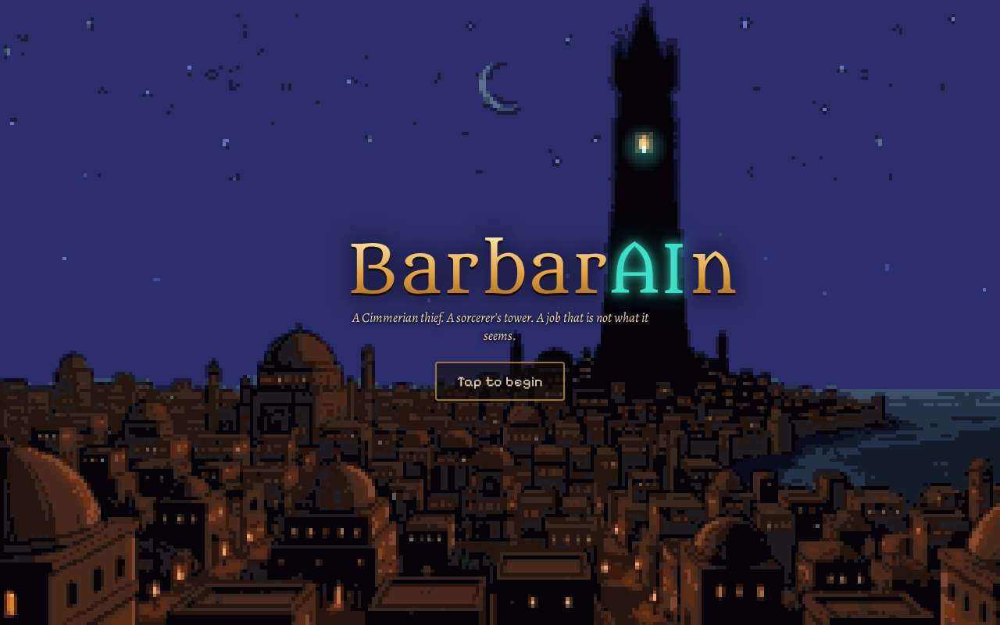
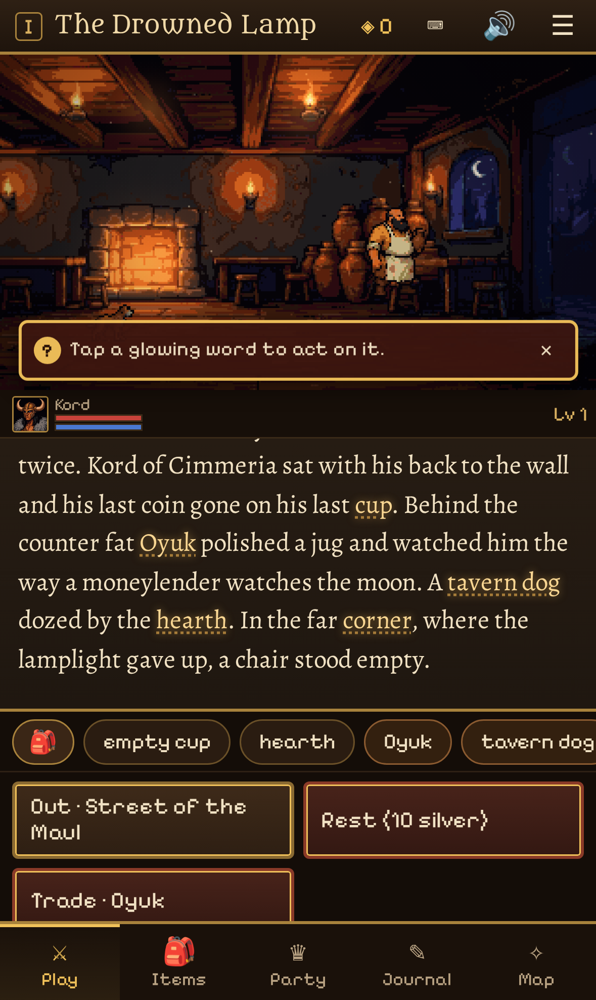
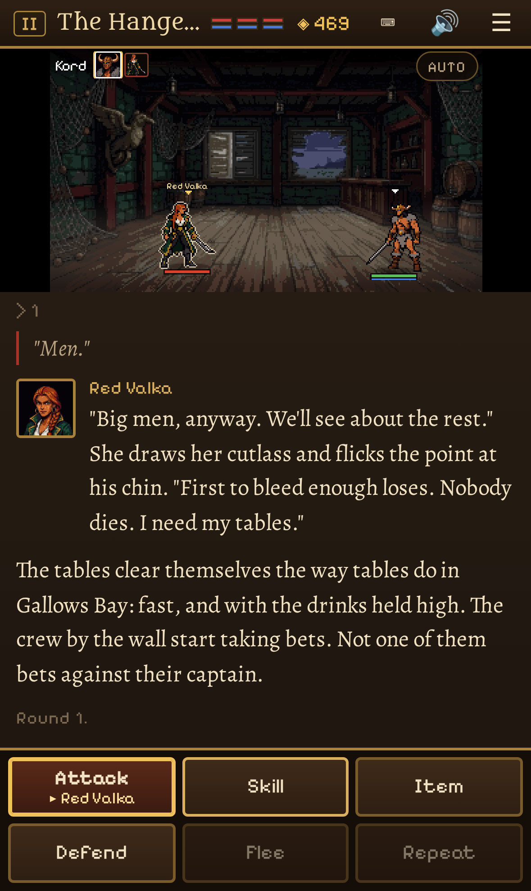
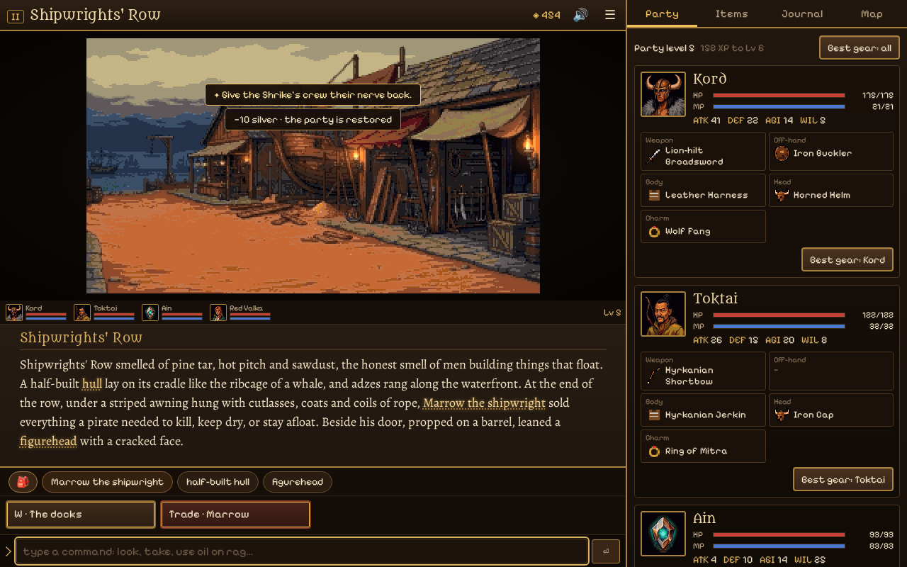
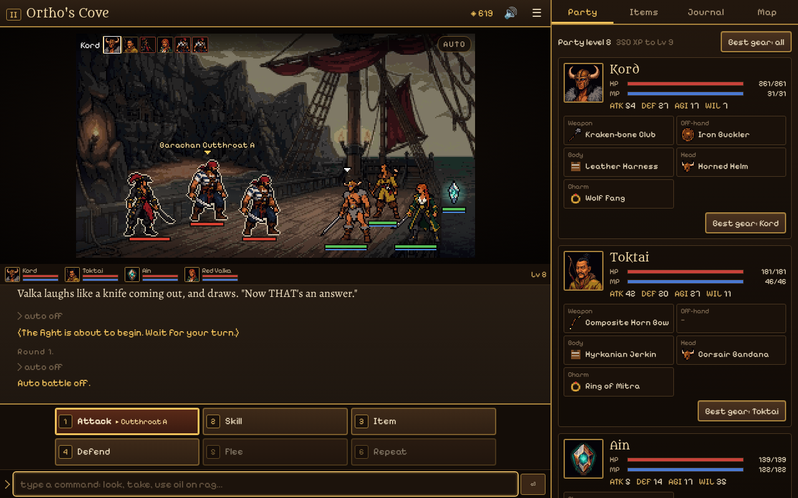
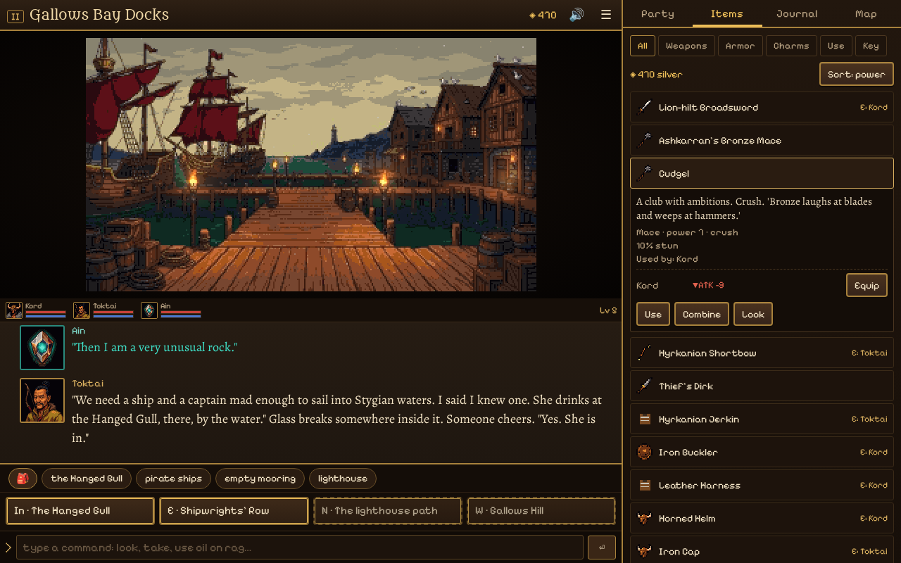
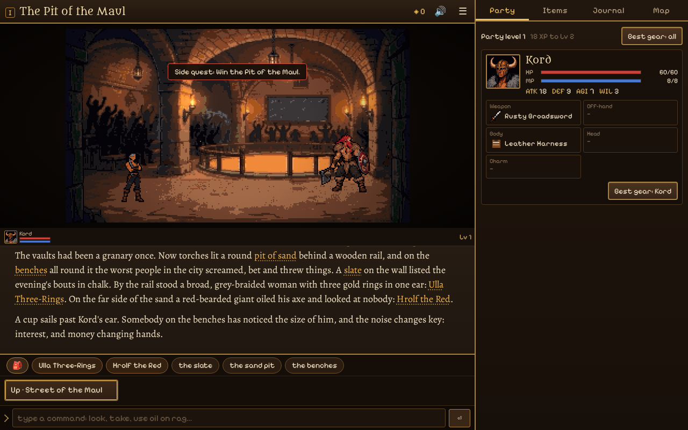
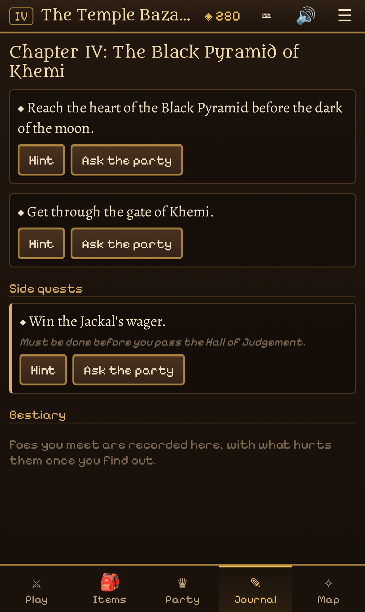

# BarbarAIn

*A Cimmerian thief. A sorcerer's tower. A job that is not what it seems.*

A sword-and-sorcery text adventure RPG set in the Hyborian Age. You play Kord
of Cimmeria, a thief hired to steal a jewel from a tower in Shadizar the
Wicked. Read the scenes, tap the glowing words, scheme your way past guards and
puzzles, and fight side-view, 16-bit battles with a party of rogues, pirates
and stranger things, across five chapters from Zamora's thieves' quarter to the
black pyramids of Stygia. The job, the jewel and the world all turn out to be
something else entirely. No spoilers here, except one: the chronicle has three
endings, and what you decide along the way chooses between them.

**[▶ Play BarbarAIn](https://barbarain.synapticnoise.com/)** in your browser. No
install, works on desktop and on phones.

## The world

| | |
|---|---|
|  |  |
| **Shadizar the Wicked.** It starts in a tavern, with your last coin and an empty chair in the corner. | **Turn-based battles.** Brawls, duels and bosses with skills, magic and weak spots to find. |
|  |  |
| **Explore.** 41 painted places: bazaars, sewers, a pirate port, sea caves, a ship at sea, Stygian streets and tombs. | **Pirates.** Gather a party: an archer-thief from the steppe, a pirate captain, and a talking jewel. |

| | |
|---|---|
|  |  |

**Gear without the chores.** Swords, axes, maces, bows, daggers and spears,
armor and charms, with filters, sorting, a side-by-side compare, one-tap
**Best gear**, and "Equip now" when you pick up something better.

## How to play

- **Look and act:** tap or click a glowing word in the text, a chip in the row
  below it, or a thing in the picture, then choose Look, Take, Use or Talk.
- **Move:** tap an exit button. On a keyboard, use the arrow keys or type `n`,
  `go market`.
- **Use and combine items:** Items, pick an item, then Use (and tap the
  target) or Combine. Or type it: `use oil on rag`, `give wine to bolo`.
- **Type if you like:** the command line understands `look`, `take`, `talk`,
  `use X on Y`, `combine`, `inventory` and more. Press `/` to jump to it.
- **Fight:** Attack, Skill, Item, Defend, Flee or Repeat (keys `1` to `6`).
  Tap an enemy to target it; `A` turns Auto battle on and off.
- **Stuck?** The Journal has the current goal and up to three hints for it.
- **Panels:** Items, Party, Journal and Map (`I`, `P`, `J`, `M`). The Map
  fast-travels to places you've been.
- **Pause, save and settings:** ☰ or Esc. **Mute:** 🔊 or Ctrl+M.
- **On a phone,** hold it upright (sideways works too) and use the tabs at the
  bottom. You can install it from your browser's menu to play full screen,
  even offline.

You can't die from a puzzle. Lose a battle and you can fight it again at once,
or switch to the gentler Saga difficulty. The game autosaves as you go and has three save slots. Five chapters take
about two hours, plus three optional side quests: a fighting pit under the streets of Shadizar, a treasure hunt
for the pirates' lost charter in Gallows Bay, and a thieves' wager in Khemi. When you reach an ending, the end screen counts the endings you have found, hints at the
others, and can take you straight back to the choices that lead to them.

## How it was made

BarbarAIn was made by [Claude Code](https://claude.com/claude-code) with
[gamegen](https://github.com/zeveck/gamegen), from this request:

> We want to make a modern-leaning text adventure. It should describe scenes and let you explore dungeons and fight monsters and gain levels and HP and MP and magic. They should use a range of weapons. Typical RPG elements. It should have relatively simple 16-bit style graphics depicting environments and towns people and the hero's party and enemies. It should have enough interface to be playable on desktop and mobile. It is called BarbarAIn. It should be heavily based on the world of Conan the Barbarian as depicted in the books and stories by author Robert E. Howard. It should have characters evoking those from the books and movies and they should behave "in character" when present. However, we want this to be a new story, and it should have at least three major twists and surprises, and they should make sense in the world. Anything goes -- robots from the future? time travel? pirates? trans-dimensional dragons? a heist? Sure, if you can make it fit into the world. There should be light adventure game style puzzles a la Secret of Monkey Island. It should have items and armor and weapons with a good quality of life system for managing inventory. Racing to say "done" but producing slop is a fail. It's fine to take longer to get it right. Be careful. Good luck!

gamegen designed the game, had review agents polish the design, made the art,
animation, music and sound with these plugins, built it, and play-tested it:

- [nanogen](https://github.com/zeveck/nanogen): the 42 location paintings, the
  key-art scenes and the 24 character portraits
- [imagegen2](https://github.com/zeveck/imagegen2): the party, enemy and
  townsfolk sprites, the props, the item icons and the app icon
- [anim8gen](https://github.com/zeveck/anim8gen): the attack animations of
  Kord, Toktai and Valka
- [audiogen](https://github.com/zeveck/audiogen): ten pieces of music and
  about 36 sound effects and ambient loops

Later it was changed with one more request, `/gamegen --change add two alternate endings, one unlocked by a choice in chapter III`, which added the choice in chapter III, the final choice, two new endings and three new key-art scenes. A second, `/gamegen --change add three optional side quests, including an arena in Shadizar`, added the Pit of the Maul, the Drowned Articles and the Jackal's Wager, with a new arena painting, three new characters and a crowd cheer.

Kord and the other characters are original, written to evoke the heroes and
villains of Robert E. Howard's stories and the films; the places and gods
are from Howard's Hyborian Age.

## Playing locally

BarbarAIn is a plain web page with no build step. Serve the `game` folder
with any static web server, for example:

    cd game
    python3 -m http.server 8000

then open http://localhost:8000.

## Credits

Fonts, each under the SIL Open Font License (the license is next to each font
in `game/fonts/`): Alegreya, Pixelify Sans, Metamorphous and Cinzel
Decorative.
